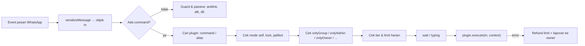

<div align="center">


**Sistem automasi WhatsApp yang terus tumbuh dan dikembangkan.**  
JavaScript · Zapo-JS · Plugin System · Interactive Message · Continuous Development

[Repository](https://github.com/Lynxcode-id/ERINE-AI) · [INF PROJECT](https://whatsapp.com/channel/0029VbCUDdOHFxOyVb2Hfe2X) · [Portfolio](https://www.lynxdev.my.id/) · [Dukung Pengembangan](https://saweria.co/LynxPreset)

[](https://github.com/Lynxcode-id/ERINE-AI)
[](https://nodejs.org/)
[](https://developer.mozilla.org/en-US/docs/Web/JavaScript)
[](https://github.com/vinikjkkj/zapo)
[](#-dokumentasi-plugin)
[](#-daftar-isi)

<br/>

**[📖 Dokumentasi Plugin](#-dokumentasi-plugin)** &nbsp;·&nbsp;
**[🎛️ Button · List · Carousel · AIRich](#️-interactive-message-button-list-carousel-airich)** &nbsp;·&nbsp;
**[🧰 function.js](#-referensi-libfunctionjs)** &nbsp;·&nbsp;
**[🧩 function2.js](#-referensi-libfunction2js-erinefunc)** &nbsp;·&nbsp;
**[🤝 Kontributor](#-kontributor)**

</div>

---

## 📑 Daftar Isi

| # | Bagian | Isi |
| :-: | --- | --- |
| 1 | [Tentang ELYRA](#-tentang-elyra) | Gambaran project dan arah pengembangan |
| 2 | [Komunitas & Tim](#-komunitas--tim) | INF PROJECT, ELYRA LABS |
| 3 | [Kontributor](#-kontributor) | Siapa saja yang membangun ELYRA |
| 4 | [Kelebihan Utama](#-kelebihan-utama) | Ringkasan fitur inti |
| 5 | [Mulai Cepat](#-mulai-cepat) | Instalasi, konfigurasi, keamanan |
| 6 | [Struktur Project](#-struktur-project) | Peta folder dan alur pesan |
| 7 | [Dokumentasi Plugin](#-dokumentasi-plugin) | Anatomi, properti, akses, objek `m`, contoh kode |
| 8 | [Interactive Message](#️-interactive-message-button-list-carousel-airich) | Button, List, Carousel, AIRich, ButtonV2 |
| 9 | [`lib/function.js`](#-referensi-libfunctionjs) | Semua helper beserta contoh |
| 10 | [`lib/function2.js`](#-referensi-libfunction2js-erinefunc) | Kelas `ErineFunc` |
| 11 | [Wrapper Socket](#-wrapper-socket-libwrapperjs) | `sendReact`, `sendAlbum`, `sendThumbnail`, dan lainnya |
| 12 | [Praktik Terbaik](#-praktik-terbaik) | Checklist plugin yang sehat |
| 13 | [Troubleshooting](#-troubleshooting) | Masalah umum dan solusinya |
| 14 | [Lainnya](#-lainnya) | Project lama, ekosistem, channel, kontak, credits |

---

## ✨ Tentang ELYRA

**ERINE-AI • ELYRA** adalah script bot WhatsApp berbasis [Zapo-JS](https://github.com/vinikjkkj/zapo) untuk automasi pesan, pengelolaan fitur berbasis plugin, dan integrasi layanan eksternal.

ELYRA bukan lagi sekadar base bot. Project ini terus dibangun sebagai script dengan struktur, sistem, dan arah pengembangan sendiri, dikembangkan oleh **Lynx Decode — Arman Maulana** bersama **Dinda Novelina**, di bawah ekosistem **INF PROJECT** dan **ELYRA LABS**.

Fokusnya bukan sekadar menambah banyak command, tetapi menjaga struktur tetap mudah dipelihara, memperbaiki masalah yang ditemukan, dan mengembangkan fitur sesuai kebutuhan serta sumber daya yang tersedia.

> **Status:** Active Development. Fitur, konfigurasi, dependensi, dan struktur internal dapat berubah sewaktu-waktu.

### Ringkasan Project

| Detail | Informasi |
| --- | --- |
| Nama | ERINE-AI • ELYRA |
| Repository | [Lynxcode-id/ERINE-AI](https://github.com/Lynxcode-id/ERINE-AI) |
| Pengembang utama | Lynx Decode — Arman Maulana |
| Pengembang kedua & QC | Dinda Novelina (Nov) |
| Komunitas | INF PROJECT · ELYRA LABS |
| Bahasa | JavaScript · ES Modules |
| Runtime | Node.js 20+ |
| Library WhatsApp | Zapo-JS |
| Penyimpanan | SQLite |
| Status | Active Development |

---

## 🌐 Komunitas & Tim

<table>
  <tr>
    <td width="50%" valign="top">

### 🟦 INF PROJECT
Komunitas dan tim besar tempat ELYRA tumbuh: berbagi source, update, dan diskusi pengembangan bot WhatsApp.

- [Channel INF Code](https://whatsapp.com/channel/0029VbCUDdOHFxOyVb2Hfe2X)
- [Channel API's](https://whatsapp.com/channel/0029VbCMzVqE50UZAnV44u05)
- [Channel L-Store](https://whatsapp.com/channel/0029Vb6eyvOJUM2caRIktb2L)

</td>
    <td width="50%" valign="top">

### 🟪 ELYRA LABS
Laboratorium pengembangan ELYRA: tempat eksperimen fitur baru, perbaikan stabilitas, dokumentasi, dan penguatan fondasi script.

- Fokus: plugin, interactive message, stabilitas, dan dokumentasi
- Pembaruan mengikuti repository dan channel INF PROJECT

</td>
  </tr>
</table>

> Ekosistem lama yang tetap menjadi bagian dari perjalanan: **INF PROJECT TEAM**, **INF PROJECT'S**, dan **GENERAL DISTRICT**.

---

## 🤝 Kontributor

<table>
  <tr>
    <td align="center" width="20%">
      <b>Lynx Decode</b><br/>
      <sub>Arman Maulana</sub><br/><br/>
      🛠️ <b>Pengembang Utama</b><br/>
      <sub>Arsitektur, core system, plugin, rilis</sub>
    </td>
    <td align="center" width="20%">
      <b>Dinda Novelina</b><br/>
      <sub>Nov</sub><br/><br/>
      🧪 <b>Pengembang Kedua & Quality Control</b><br/>
      <sub>Pengujian, pengecekan kualitas, dan masukan fitur</sub>
    </td>
    <td align="center" width="20%">
      <b>Claude</b><br/>
      <sub>Anthropic</sub><br/><br/>
      🤖 <b>AI Dev Partner</b><br/>
      <sub>Code review, refactor, debugging, dokumentasi</sub>
    </td>
    <td align="center" width="20%">
      <b>DeepSeek</b><br/>
      <sub>DeepSeek AI</sub><br/><br/>
      🤖 <b>AI Assistant</b><br/>
      <sub>Ide logika, bantuan debugging, dan optimasi</sub>
    </td>
    <td align="center" width="20%">
      <b>Gemini</b><br/>
      <sub>Google</sub><br/><br/>
      🤖 <b>AI Assistant</b><br/>
      <sub>Riset, brainstorming fitur, dan draft dokumentasi</sub>
    </td>
  </tr>
</table>

> Asisten AI membantu mempercepat kerja, sedangkan keputusan desain, review, dan rilis tetap ditangani tim manusia ELYRA.

---

## 🚀 Kelebihan Utama

- **Plugin modular** — fitur dikelompokkan per folder agar mudah ditambah, diperbaiki, dan dipelihara.
- **Hot reload plugin** — loader memuat ulang plugin dengan import segar, mendeteksi duplikat command, dan melaporkan plugin yang error tanpa menjatuhkan bot.
- **Interactive message lengkap** — `Button`, `ButtonV2`, `Carousel`, dan **AIRich** (teks kaya, kode, tabel, produk, post, reels, sumber, widget, edit langsung).
- **Sistem akses berlapis** — owner, grup, admin, bot-admin, private, tier Free/Premium/VIP, dan limit harian.
- **Penyimpanan SQLite** — sesi dan data tertentu tanpa server database terpisah.
- **Penanganan error** — error plugin dilaporkan ke owner lengkap dengan lokasi file, sementara pengguna tetap mendapat balasan yang rapi.
- **Dukungan media** — gambar, video, audio, voice note, dokumen, stiker, album, sticker pack, thumbnail, dan link preview.
- **Jadibot** — bot turunan dengan pembatasan fitur sensitif secara otomatis.
- **Integrasi layanan eksternal** — API dan layanan pihak ketiga dikelola lewat `settings.js` dan environment variable.
- **Pemeliharaan berkelanjutan** — perbaikan bug, kompatibilitas, dan fitur baru dilakukan bertahap.

> Performa dan ketersediaan fitur bergantung pada versi library, sistem operasi, konfigurasi, dan beban server. Daftar ini menjelaskan arah desain, bukan jaminan bahwa semua kondisi selalu bebas gangguan.

---

## ⚡ Mulai Cepat

<details open>
<summary><strong>1 · Instalasi dan menjalankan bot</strong></summary>

<br/>

**Persyaratan:** Node.js 20 atau versi yang kompatibel dengan dependensi, npm, koneksi internet, serta FFmpeg dan FFprobe untuk fitur media.

```bash
git clone https://github.com/Lynxcode-id/ERINE-AI.git
cd ERINE-AI
npm install
npm start
```

Jika `package.json` mengatur `postinstall` untuk menjalankan `patch.js`, patch berjalan sesuai konfigurasi package. Ikuti instruksi autentikasi yang muncul di terminal (mode pairing code diatur lewat `usePairingCode` di `settings.js`). Entry point dan perintah start mengikuti `package.json` versi repository yang digunakan.

</details>

<details>
<summary><strong>2 · Konfigurasi (<code>settings.js</code>)</strong></summary>

<br/>

Semua pengaturan bot ada di `settings.js` dan diekspor sebagai `settings` (alias `config`).

| Kunci | Fungsi |
| --- | --- |
| `usePairingCode` | `true` untuk login memakai pairing code |
| `customPairing` | Kode pairing kustom |
| `noprefix` | `true` agar command bisa dipakai tanpa prefix |
| `prefixes` | Daftar prefix, contoh `['!', '.']` |
| `self` | Mode self: hanya owner yang dilayani |
| `owner` / `ownerName` | Nomor dan nama owner |
| `botName` / `botNumber` | Identitas bot |
| `stickerPack` / `stickerAuthor` | Watermark stiker default |
| `jidGroup` | Grup tujuan laporan error ke owner |
| `eventMessage` / `eventAll` | Debug: cetak event mentah ke terminal |
| `pesan.*` | Teks bawaan: `wait`, `error`, `done`, `ownerOnly`, `groupOnly`, `privateOnly`, `adminOnly`, `botAdmin` |

Endpoint API tersedia sebagai variabel global (`global.lynxapis`, `global.theresav`, dan lainnya), sedangkan API key berada di `global.apikey.*` dan **dapat di-override lewat environment variable**:

```bash
APIKEY_THERESAV=xxxx
APIKEY_JEREXD=xxxx
APIKEY_VAMX=xxxx
APIKEY_CMNTY=xxxx
APIKEY_JAGOAN=xxxx
APIKEY_OCRSPACE=xxxx
TERMAI_KEY=xxxx
CATBOX_USERHASH=xxxx
```

Mengubah setting saat bot berjalan dapat memakai `updateSetting(key, value)` (alias `updateConfig`). Fungsi ini menulis ulang baris properti di `settings.js` dan hanya mendukung nilai primitif atau array, bukan object.

```js
import { updateSetting } from './settings.js'

updateSetting('noprefix', false)
updateSetting('prefixes', ['.', '#'])
```

</details>

<details>
<summary><strong>3 · Keamanan dan <code>.gitignore</code></strong></summary>

<br/>

Jangan mengunggah kredensial, sesi, token, API key privat, file `.env`, atau database yang berisi data sensitif. **Gunakan environment variable untuk semua key**, dan jangan menyimpan key asli sebagai nilai bawaan di `settings.js` pada repository publik.

```gitignore
node_modules/
session/
auth/
store/
.env
.env.*
*.db
*.sqlite
*.sqlite3
npm-debug.log*
```

Sesuaikan aturan dengan kebutuhan project. Jangan mengecualikan source code atau data contoh yang memang diperlukan.

</details>

---

## 🗂️ Struktur Project

```text
ELYRA/
├── index.js                 # entry point: socket, handler, scheduler
├── handler.js               # serializeMessage() → objek `m`, helper eval
├── settings.js              # konfigurasi, endpoint, API key (env)
├── patch.js                 # patch dependensi
├── src/
│   ├── createSocket.js      # membuat socket Zapo-JS
│   ├── connectionHandler.js # koneksi & autentikasi
│   ├── messageHandler.js    # pipeline command (akses, tier, execute)
│   └── groupEventHandler.js # event grup
├── lib/                     # helper inti (lihat dokumentasi di bawah)
│   ├── function.js          # helper umum: cmdId, sendList, starforge, eval
│   ├── function2.js         # kelas ErineFunc
│   ├── wrapper.js           # sock.sendReact / sendAlbum / sendThumbnail ...
│   ├── baileys-mbuilder.js  # builder: Button, ButtonV2, Carousel, AIRich
│   ├── message-builder2.js  # builder v4.7 (API chain .quote(m))
│   ├── loadPlugins.js       # loader plugin + reload + deteksi duplikat
│   ├── pluginTags.js        # tag & kategori menu
│   ├── tier.js              # Free / Premium / VIP + limit harian
│   └── ...                  # utils, ban, whitelist, welcome, jadibot, dll.
├── db/                      # akses SQLite (user, group, contacts, ...)
├── scrape/                  # scraper pendukung plugin
├── media/                   # aset statis
└── plugins/                 # ⬅ semua fitur bot
    ├── ai/  bot/  chanel/  downloader/  fun/  grup/  image/  info/
    ├── jadibot/  konvert/  maker/  music/  owner/  search/
    └── sticker/  stalking/  tools/  uploader/
```

### Alur sebuah pesan



---

## 📖 Dokumentasi Plugin

Setiap file `.js` di dalam `plugins/` (rekursif) dibaca oleh loader. File dianggap plugin valid bila **export default**-nya punya `command` (string) dan `execute` (function). File lain dilewati (`SKIP`), dan file yang gagal di-import ditandai `ERROR` di log tanpa menghentikan plugin lain.

### 1. Anatomi plugin

```js
// plugins/tools/halo.js
export default {
  command: 'halo',
  alias: ['hi', 'hai'],
  category: 'tools',
  tags: ['tools'],
  description: `> Menyapa pengguna.

*Keterangan Format:*
> \`[nama]\` = nama yang ingin disapa (opsional).

contoh penggunaan:
> \`.halo Arman\``,
  help: '[nama]',
  typing: true,

  async execute(m, { sock, args }) {
    const nama = args.join(' ') || m.pushName || 'kak'
    await m.reply(`Halo ${nama}! 🌷`)
  }
}
```

> **Penting:** `category` otomatis diisi dari **nama folder** tempat file berada (nilai yang kamu tulis disimpan sebagai `declaredCategory`). Letakkan plugin di folder yang sesuai, dan gunakan `tags` bila ingin tampil di beberapa kategori menu.

### 2. Referensi properti plugin

| Properti | Tipe | Fungsi |
| --- | --- | --- |
| `command` | `string` **wajib** | Nama command utama (huruf kecil) |
| `execute` | `async (m, ctx) => {}` **wajib** | Logika plugin |
| `alias` / `aliases` | `string` \| `string[]` | Nama lain untuk command yang sama |
| `category` | `string` | Diganti otomatis oleh nama folder |
| `tags` / `tag` | `string` \| `string[]` | Kategori tampilan menu (boleh banyak, dipisah `,` `;` `\|`) |
| `description` | `string` | Penjelasan fitur (format markdown WhatsApp) |
| `help` | `string` | Petunjuk argumen, contoh `'<url>'` atau `'[kategori\|all]'` |
| `typing` | `boolean` | Tampilkan status "sedang mengetik" selama plugin berjalan |
| `wait` | `boolean` | Kirim `config.pesan.wait` sebelum eksekusi |
| `hidden` | `boolean` | Sembunyikan dari menu |
| `onlyOwner` / `ownerOnly` | `boolean` | Hanya owner |
| `onlyGroup` / `groupOnly` | `boolean` | Hanya di grup |
| `onlyPrivate` / `privateOnly` | `boolean` | Hanya di chat pribadi |
| `onlyAdmin` / `adminOnly` | `boolean` | Hanya admin grup |
| `onlyBotAdmin` / `botAdminOnly` | `boolean` | Bot harus admin grup |
| `tier` | `'free'` \| `'premium'` \| `'vip'` | Tier minimum |
| `premium` / `onlyPremium` | `boolean` | Shortcut `tier: 'premium'` |
| `vip` / `onlyVip` | `boolean` | Shortcut `tier: 'vip'` |
| `limit` | `number` \| `false` | Biaya limit harian per pemakaian |
| `noChild` | `boolean` | Tidak tersedia di jadibot |

Tag dinormalkan otomatis: huruf kecil, spasi menjadi `-`, maksimal 24 karakter. Beberapa alias dipetakan ke kategori standar, misalnya `download` → `downloader`, `tool` → `tools`, `group` → `grup`, `channel` → `chanel`, `convert` → `konvert`.

### 3. Urutan pengecekan sebelum `execute`

1. Plugin dicari lewat `command` atau `alias` (tanpa membedakan huruf besar/kecil).
2. **Jadibot:** plugin `noChild`, owner-only, dan berbayar diblokir di bot turunan.
3. **Mode self / lock:** non-owner diabaikan bila mode aktif (kecuali fitur *trusted*).
4. `onlyGroup` dicek, lalu aturan grup `onlyadmin`.
5. `onlyOwner`, `onlyPrivate`, `onlyAdmin`, `onlyBotAdmin` (owner dan fitur *trusted* melewati bagian ini).
6. **Tier & limit** lewat `checkAccess()`.
7. Kirim pesan `wait` (bila `wait: true`) dan mulai `typing` (bila `typing: true`).
8. `plugin.execute(m, context)` dijalankan. Bila melempar error, limit yang terpakai **dikembalikan otomatis** dan error diteruskan ke penanganan error.

### 4. Tier dan limit harian

| Tier | Limit per hari |
| --- | :-: |
| Free | 20 |
| Premium ⭐ | 150 |
| VIP 👑 | 500 |

- Biaya default adalah **1** per pemakaian. Kategori `bot`, `owner`, `grup`, dan `info` bernilai **0** secara default.
- `limit: false` membuat plugin gratis, sedangkan `limit: 3` membuat plugin memakan 3 limit.
- Owner tidak dibatasi.

```js
export default {
  command: 'hdvideo',
  tier: 'premium',   // minimal premium
  limit: 3,          // memakan 3 limit
  wait: true,
  async execute(m, { sock }) { /* ... */ }
}
```

### 5. Objek `m` (pesan masuk)

| Properti | Isi |
| --- | --- |
| `m.raw` | Event mentah (dipakai untuk `quote`) |
| `m.key`, `m.id` | Key dan ID pesan |
| `m.chat` | JID chat tujuan balasan |
| `m.sender` | JID pengirim |
| `m.isGroup`, `m.isBroadcast`, `m.isNewsletter` | Jenis chat |
| `m.isOwner`, `m.isFromMe` | Status pengirim |
| `m.type` | Tipe pesan (`conversation`, `imageMessage`, ...) |
| `m.text` / `m.body` | Teks pesan (untuk balasan tombol: id tombolnya) |
| `m.prefix`, `m.command`, `m.args` | Hasil parsing command |
| `m.isMedia`, `m.mediaType`, `m.caption` | Info media (`image`, `video`, `audio`, `sticker`, `document`, `file`) |
| `m.mentionedJid` | Daftar JID yang di-mention |
| `m.pushName`, `m.contact` | Nama dan data kontak (`jid`, `lid`, `phoneNumber`, `isSaved`) |
| `m.quoted` | Pesan yang di-reply (lihat bawah), `null` bila tidak ada |
| `m.groupMetadata(jid?)` | Ambil metadata grup |
| `m.groupName`, `m.participants` | *Khusus grup* |
| `m.isAdmin`, `m.isBotAdmin`, `m.isOwnerGroup` | *Khusus grup* |
| `m.reply(...)` | Kirim balasan (lihat bawah) |

**`m.quoted`** memiliki: `key`, `sender`, `type`, `text`, `mime`, `isMedia`, `mediaType`, `caption`, `fromMe`, `pushName`, `contact`, `mentionJid`, `isAdmin` (grup), `full`, `json`, dan method `download()` yang mengembalikan bytes media.

**`m.reply`** menerima tiga bentuk:

```js
await m.reply('Teks biasa')                              // (content)
await m.reply('Halo @628xxx', { mentions: [jid] })       // (content, options)
await m.reply(jidTujuan, 'Halo', { mentions: [jid] })    // (jid, content, options)

await m.reply({ type: 'image', media: buffer, caption: 'Ini gambarnya' })
```

Bila teks memuat `@angka` tanpa `mentions`, pengirim otomatis di-mention.

### 6. Argumen kedua `execute`

```js
async execute(m, { sock, args, plugins, child }) { }
```

| Nama | Isi |
| --- | --- |
| `sock` | Socket Zapo-JS beserta wrapper ELYRA |
| `args` | Argumen setelah command, sudah dipecah per spasi |
| `plugins` | `Map` seluruh plugin (`global.plugins`) |
| `child` | Info jadibot bila dipanggil dari bot turunan, selain itu `null` |

### 7. Mengirim pesan dengan `sock.message.send`

```js
await sock.message.send(jid, payload, options)
```

| Jenis | Payload |
| --- | --- |
| Teks | `'Halo'` |
| Gambar | `{ type: 'image', media: buffer, mimetype: 'image/jpeg', caption }` |
| Video | `{ type: 'video', media: buffer, mimetype: 'video/mp4', caption }` |
| Audio / VN | `{ type: 'audio', media: buffer, mimetype: 'audio/ogg; codecs=opus', ptt: true }` |
| Dokumen | `{ type: 'document', media: buffer, mimetype, fileName, caption }` |
| Stiker | `{ type: 'sticker', media: buffer }` |
| Reaction | `{ type: 'reaction', emoji: '👍', target: m.key }` |
| Pesan proto mentah | `{ contactMessage: {...} }`, `{ interactiveMessage: {...} }`, dan sejenisnya |

Opsi yang sering dipakai: `quote` (isi dengan `m.raw`), `mentions` (array JID), `editKey: { id }` (mengedit pesan sebelumnya), dan `additionalAttributes`.

Perintah lain di socket: `sock.message.downloadBytes(rawMessage)`, `sock.message.upload(buffer, { type, mimetype })`, `sock.presence.sendChatstate(jid, { state })`, `sock.getCredentials()`, dan `sock.group.*` (misalnya `removeParticipants`).

---

### 🧪 Contoh plugin

<details open>
<summary><strong>A · Command dengan argumen dan validasi</strong></summary>

```js
// plugins/tools/hitung.js
export default {
  command: 'hitung',
  alias: ['calc'],
  category: 'tools',
  tags: ['tools'],
  description: '> Menghitung dua angka.\n\ncontoh penggunaan:\n> `.hitung 12 + 8`',
  help: '<angka> <+|-|*|/> <angka>',
  typing: true,

  async execute(m, { args }) {
    const [a, op, b] = args
    const x = Number(a), y = Number(b)
    const p = m.prefix || '.'

    if (!a || !op || !b || Number.isNaN(x) || Number.isNaN(y)) {
      return m.reply(`Format salah.\nContoh: \`${p}${m.command} 12 + 8\``)
    }

    const ops = { '+': x + y, '-': x - y, '*': x * y, '/': y === 0 ? NaN : x / y }
    if (!(op in ops)) return m.reply('Operator harus + - * atau /')

    await m.reply(`🧮 Hasil: *${ops[op]}*`)
  }
}
```

</details>

<details>
<summary><strong>B · Khusus grup, admin, dan bot-admin</strong></summary>

```js
// plugins/grup/sapa.js
export default {
  command: 'sapaadmin',
  category: 'grup',
  tags: ['grup'],
  description: '> Menyebut seluruh admin grup.',
  help: '',
  onlyGroup: true,
  onlyAdmin: true,      // pengirim harus admin
  onlyBotAdmin: true,   // bot juga harus admin
  typing: true,

  async execute(m, { sock }) {
    const admins = m.participants.filter(p => p.admin).map(p => p.id || p.jid).filter(Boolean)
    const text = ['👑 *Admin Grup*', '', ...admins.map(j => `• @${j.split('@')[0]}`)].join('\n')
    await m.reply(text, { mentions: admins })
  }
}
```

> Bentuk data `participants` mengikuti cache metadata grup. Untuk aksi mengeluarkan/menaikkan anggota, lihat `executeParticipantAction` di `lib/utils.js` dan contoh `plugins/grup/kick.js`.

</details>

<details>
<summary><strong>C · Mengunduh media dari pesan atau reply</strong></summary>

```js
// plugins/image/sizeimg.js
export default {
  command: 'sizeimg',
  category: 'image',
  tags: ['image', 'tools'],
  description: '> Menampilkan ukuran file gambar.\n\ncontoh penggunaan:\n> kirim gambar dengan caption `.sizeimg`, atau reply gambar.',
  help: '(reply/kirim gambar)',
  wait: true,
  typing: true,

  async execute(m, { sock }) {
    const target = m.quoted?.mediaType === 'image' ? m.quoted : m
    if (target.mediaType !== 'image') {
      return m.reply('Kirim atau reply sebuah gambar dulu ya.')
    }

    const bytes = target === m
      ? await sock.message.downloadBytes(m.raw.message)   // gambar di pesan ini
      : await m.quoted.download()                        // gambar dari reply

    const buffer = Buffer.from(bytes)
    await m.reply(`📦 Ukuran gambar: ${(buffer.length / 1024).toFixed(1)} KB`)
  }
}
```

</details>

<details>
<summary><strong>D · Mengirim gambar, video, dokumen, dan voice note</strong></summary>

```js
// plugins/tools/kirimmedia.js
import axios from 'axios'

const get = async (url) =>
  Buffer.from((await axios.get(url, { responseType: 'arraybuffer', timeout: 20000 })).data)

export default {
  command: 'kirimmedia',
  category: 'tools',
  tags: ['tools'],
  description: '> Contoh mengirim berbagai jenis media.',
  help: '<image|video|doc|vn> <url>',
  wait: true,
  typing: true,

  async execute(m, { sock, args }) {
    const [jenis, url] = args
    if (!jenis || !url) return m.reply('Contoh: `.kirimmedia image https://...`')

    const media = await get(url)
    const quote = { quote: m.raw }

    switch (jenis) {
      case 'image':
        return sock.message.send(m.chat, { type: 'image', media, mimetype: 'image/jpeg', caption: '🌷 Ini gambarnya' }, quote)
      case 'video':
        return sock.message.send(m.chat, { type: 'video', media, mimetype: 'video/mp4', caption: '🎬 Ini videonya' }, quote)
      case 'doc':
        return sock.message.send(m.chat, { type: 'document', media, mimetype: 'application/octet-stream', fileName: 'file.bin', caption: '📎 Ini filenya' }, quote)
      case 'vn':
        return sock.sendVoiceNote(m.chat, media, { quote: m.raw })   // otomatis jadi PTT
      default:
        return m.reply('Jenis harus: image | video | doc | vn')
    }
  }
}
```

</details>

<details>
<summary><strong>E · Reaction, edit pesan, dan penanganan error</strong></summary>

```js
// plugins/bot/pingcontoh.js
export default {
  command: 'pingcontoh',
  category: 'bot',
  tags: ['bot'],
  description: '> Menghitung latency, memakai reaction dan edit pesan.',
  help: '',
  typing: true,

  async execute(m, { sock }) {
    await sock.sendReact(m.chat, '🌱', m.id).catch(() => {})
    const start = Date.now()

    try {
      const sent = await m.reply('⏳ Menghitung...')
      const ms = Date.now() - start

      // mengedit pesan yang barusan dikirim
      await sock.message.send(m.chat, `🏓 Pong! ${ms}ms`, { editKey: { id: sent.id } })
      await sock.sendReact(m.chat, '💐', m.id).catch(() => {})
    } catch (err) {
      console.error('[PINGCONTOH]', err?.message || err)
      await sock.sendReact(m.chat, '☘️', m.id).catch(() => {})
      await m.reply('❌ Terjadi kesalahan.')
    }
  }
}
```

> Error yang **tidak** ditangkap di dalam `execute` akan diteruskan ke penanganan error global (`sendErrorToOwner`), jadi owner tetap mendapat laporan beserta lokasi file.

</details>

<details>
<summary><strong>F · Album, sticker pack, dan link preview</strong></summary>

```js
// plugins/tools/galeri.js
import { sendLinkPreview } from '../../lib/function.js'

export default {
  command: 'galeri',
  category: 'tools',
  tags: ['tools'],
  description: '> Contoh album foto dan link preview.',
  help: '',
  typing: true,

  async execute(m, { sock }) {
    // 1. Album (beberapa gambar sekaligus)
    await sock.sendAlbum(m.chat, [
      'https://example.com/1.jpg',
      'https://example.com/2.jpg'
    ], { quote: m.raw, caption: 'Album contoh' })

    // 2. Link preview dengan thumbnail besar
    await sendLinkPreview(sock, m, {
      text: '🌷 *ELYRA*\nSistem automasi WhatsApp.',
      title: 'ERINE-AI',
      description: 'Klik untuk membuka repository',
      thumbnail: 'https://raw.githubusercontent.com/Lynxcode-id/picture/main/1793084330598.jpeg',
      url: 'https://github.com/Lynxcode-id/ERINE-AI',
      largeThumbnail: true
    })
  }
}
```

Untuk sticker pack: `sock.sendStickerPack(m.chat, 'Nama Pack', [url1, url2, ...], { quoted: m, publisher: 'Elyra' })`. Pack dipecah otomatis per 60 stiker (`perPack`).

</details>

<details>
<summary><strong>G · Plugin owner saja</strong></summary>

```js
// plugins/owner/statusbot.js
import os from 'node:os'

export default {
  command: 'statusbot',
  alias: ['stbot'],
  category: 'owner',
  tags: ['owner'],
  description: '> Menampilkan status server singkat (khusus owner).',
  help: '',
  onlyOwner: true,
  noChild: true,   // tidak tersedia di jadibot
  typing: true,

  async execute(m) {
    const ram = ((os.totalmem() - os.freemem()) / 1024 / 1024).toFixed(0)
    await m.reply(`🖥️ *Status Server*\n• RAM terpakai: ${ram} MB\n• Uptime: ${(process.uptime() / 60).toFixed(1)} menit`)
  }
}
```

</details>

---

## 🎛️ Interactive Message: Button, List, Carousel, AIRich

ELYRA menyediakan tiga jalur untuk pesan interaktif. Pilih sesuai kebutuhan:

| Jalur | Cocok untuk | File |
| --- | --- | --- |
| **Builder** (`Button`, `ButtonV2`, `Carousel`, `AIRich`) | Kontrol penuh: CTA, list, sheet, carousel, pesan kaya | `lib/baileys-mbuilder.js`, `lib/message-builder2.js` |
| **Helper cepat** (`sendList`, `sendButtons`, `sendCards`) | Cukup kirim list/kartu dengan sedikit kode | `lib/function.js` |
| **Raw proto** (`interactiveMessage`) | Struktur persis sesuai kebutuhan | contoh: `plugins/bot/testbutton.js` |

### Dua versi builder

| | `lib/baileys-mbuilder.js` (`4.7-zapo`) | `lib/message-builder2.js` (`4.7`) |
| --- | --- | --- |
| Gaya quote | `.send(m.chat, { quoted: m })` | `.quote(m).send(m.chat)` |
| Quote tingkat relay | opsi `quote: m.raw` | opsi `quote: m.raw` |
| `Button.setVideo()` | ✅ ada | pakai `setMedia({ video: ... })` |
| Class error khusus | tidak diekspor | `AIRichError`, `ItemNotFoundError`, `DuplicateIdError`, `InvalidTargetError`, `ContentValidationError` |
| Contoh plugin | `plugins/bot/testmb.js`, `plugins/info/sc.js` | `plugins/bot/testmb2.js`, `plugins/bot/ping2.js` |

Kedua versi punya API pembangun (`setTitle`, `setBody`, `addReply`, `addUrl`, `addText`, dst.) yang sama. Perbedaan utama hanya pada cara menempelkan quote dan kelengkapan beberapa method.

### Menangani klik tombol

Klik pada tombol atau baris list **masuk kembali sebagai pesan teks** berisi `id` tombol tersebut (`m.text`). Karena itu cara paling mudah adalah mengisi `id` dengan command lengkap memakai `cmdId()`:

```js
import { cmdId } from '../../lib/function.js'

cmdId('ping')            // '.ping'  (atau 'ping' bila noprefix aktif)
cmdId('play', 'lagu')    // '.play lagu'
```

Tombol dengan `id: cmdId('ping')` akan langsung menjalankan plugin `ping` saat ditekan. Untuk membedakan klik tombol dari teks biasa, pakai `isButtonReply(m)` (tipe `interactiveResponseMessage`, `templateButtonReplyMessage`, `buttonsResponseMessage`, atau `listResponseMessage`).

---

### 🔘 Button (native flow)

Impor dan buat instance dengan `sock`:

```js
import { Button } from '../../lib/baileys-mbuilder.js'
import { cmdId } from '../../lib/function.js'
```

**Referensi method `Button`**

| Method | Fungsi |
| --- | --- |
| `setTitle(str)` / `setSubtitle(str)` | Judul dan subjudul header |
| `setBody(str)` | Isi pesan |
| `setFooter(str)` | Footer |
| `setImage(src, opts?)` | Header gambar (URL atau Buffer) |
| `setVideo(src, opts?)` | Header video (hanya `baileys-mbuilder`) |
| `setDocument(src, opts?)` | Header dokumen |
| `setMedia(obj)` | Header media kustom, contoh `{ video: url }` |
| `addReply(text, id, opts?)` | Tombol quick reply |
| `addUrl(text, url, webview?, opts?)` | Tombol buka tautan |
| `addCopy(text, code, opts?)` | Tombol salin kode |
| `addCall(text, id, opts?)` | Tombol telepon (`{ phone_number }`) |
| `addReminder` / `addCancelReminder` | Tombol pengingat |
| `addAddress(text, id, opts?)` | Tombol alamat |
| `addLocation(opts?)` | Tombol kirim lokasi |
| `addSelection(title, opts?)` | Tombol pembuka **list** |
| `makeSection(title, highlightLabel?)` | Tambah section di selection terakhir |
| `makeRow(header, title, description, id)` | Tambah baris di section terakhir |
| `addButton(name, params)` | Tombol native flow mentah |
| `setParams(obj)` | `messageParams` (mis. `bottom_sheet`) |
| `clearButtons()` | Kosongkan tombol |
| `setContextInfo(obj)` / `addPayload(obj)` | Context dan payload tambahan |
| `toCard()` | Ubah jadi kartu (untuk `Carousel`) |
| `send(jid, opts?)` | Kirim |

Parameter `setParams` yang dikenali: `limited_time_offer` (`text`, `url`, `copy_code`, `expiration_time`), `bottom_sheet` (`in_thread_buttons_limit`, `divider_indices`, `list_title`, `button_title`), dan `tap_target_configuration` (`title`, `description`, `canonical_url`, `domain`, `buttonIndex`).

<details open>
<summary><strong>Contoh 1 · Tombol CTA lengkap</strong></summary>

```js
// plugins/tools/tombol.js
import { Button } from '../../lib/baileys-mbuilder.js'
import { cmdId } from '../../lib/function.js'

export default {
  command: 'tombol',
  category: 'tools',
  tags: ['tools'],
  description: '> Contoh tombol native flow: reply, url, copy, call.',
  help: '',
  typing: true,

  async execute(m, { sock }) {
    await new Button(sock)
      .setTitle('🌷 Elyra')
      .setBody('Pilih salah satu tombol di bawah.')
      .setFooter('Elyra • mbuilder')
      .addReply('🏓 Ping', cmdId('ping'))
      .addReply('⏱️ Runtime', cmdId('runtime'))
      .addUrl('🌐 Repository', 'https://github.com/Lynxcode-id/ERINE-AI')
      .addCopy('📋 Salin Kode', 'ELYRA-123')
      .addCall('📞 Hubungi', 'call_1', { phone_number: '+6288258041396' })
      .send(m.chat, { quoted: m })
  }
}
```

</details>

<details>
<summary><strong>Contoh 2 · Tombol dengan header gambar</strong></summary>

```js
await new Button(sock)
  .setImage('https://raw.githubusercontent.com/Lynxcode-id/picture/main/1793084330598.jpeg')
  .setBody('Tombol dengan header gambar.')
  .setFooter('Elyra • mbuilder')
  .addReply('🏓 Ping', cmdId('ping'))
  .addUrl('🌐 Buka', 'https://github.com/Lynxcode-id/ERINE-AI')
  .send(m.chat, { quoted: m })
```

</details>

<details>
<summary><strong>Contoh 3 · List (selection, section, row)</strong></summary>

```js
await new Button(sock)
  .setTitle('📋 Menu')
  .setBody('Tekan tombol di bawah untuk memilih.')
  .setFooter('Elyra • mbuilder')
  .addSelection('Pilih Menu')
    .makeSection('Bot', 'Populer')
      .makeRow('', 'Ping', 'Cek latency bot', cmdId('ping'))
      .makeRow('', 'Runtime', 'Cek uptime bot', cmdId('runtime'))
    .makeSection('Info')
      .makeRow('', 'Owner', 'Kontak owner', cmdId('owner'))
      .makeRow('', 'Menu', 'Buka menu utama', cmdId('menu'))
  .send(m.chat, { quoted: m })
```

> Urutan penting: `addSelection` dulu, lalu `makeSection`, lalu `makeRow`. Memanggil `makeRow` tanpa section akan melempar error.

</details>

<details>
<summary><strong>Contoh 4 · Bottom sheet</strong></summary>

Tombol melebihi batas `in_thread_buttons_limit` akan terlipat ke dalam sheet.

```js
await new Button(sock)
  .setBody('Bottom sheet — tombol lain terlipat ke sheet.')
  .setFooter('Elyra • mbuilder')
  .addReply('Opsi 1', cmdId('ping'))
  .addReply('Opsi 2', cmdId('runtime'))
  .addReply('Opsi 3', cmdId('owner'))
  .addCopy('Salin Kode', 'ZAPO123')
  .setParams({ bottom_sheet: { in_thread_buttons_limit: 1, list_title: 'Pilihan', button_title: 'Buka Opsi' } })
  .send(m.chat, { quoted: m })
```

</details>

<details>
<summary><strong>Contoh 5 · Gaya <code>message-builder2</code> (<code>.quote(m)</code>)</strong></summary>

```js
import { Button } from '../../lib/message-builder2.js'

await new Button(sock)
  .setTitle('Test Button')
  .setBody('Versi message-builder2.')
  .setFooter('with love, elyra !!')
  .addReply('Ping', cmdId('ping'))
  .addUrl('Buka GitHub', 'https://github.com')
  .quote(m)              // quote lewat chain
  .send(m.chat)
```

</details>

---

### 🔲 ButtonV2 (legacy `buttonsMessage`)

Tombol klasik dengan thumbnail. Minimal satu tombol wajib ada.

| Method | Fungsi |
| --- | --- |
| `setTitle`, `setSubtitle`, `setBody`, `setFooter` | Teks pesan |
| `setThumbnail(src)` | Thumbnail dari URL/Buffer |
| `setRawThumbnail(x)` | Thumbnail mentah |
| `addButton(text, id?)` | Tambah tombol (`id` default: UUID acak) |
| `addRawButton(obj)` | Tombol mentah |
| `setMedia(obj)` | Media kustom |
| `send(jid, opts?)` | Kirim |

```js
import { ButtonV2 } from '../../lib/baileys-mbuilder.js'

await new ButtonV2(sock)
  .setTitle('ButtonV2')
  .setSubtitle('Legacy buttonsMessage')
  .setThumbnail('https://raw.githubusercontent.com/Lynxcode-id/picture/main/1793084330598.jpeg')
  .setBody('Tombol klasik.')
  .setFooter('Elyra • mbuilder')
  .addButton('🏓 Ping', cmdId('ping'))
  .addButton('⏱️ Runtime', cmdId('runtime'))
  .send(m.chat, { quoted: m })
```

---

### 🎠 Carousel

Carousel dibuat dari kumpulan **kartu**. Setiap kartu adalah `Button` yang diubah dengan `.toCard()`, dan **wajib punya media header** (gambar/video), kalau tidak `addCard` melempar error.

| Method | Fungsi |
| --- | --- |
| `setBody(str)` / `setFooter(str)` | Teks utama carousel |
| `addCard(card \| card[])` | Tambah satu atau banyak kartu |
| `send(jid, opts?)` | Kirim |

```js
import { Button, Carousel } from '../../lib/baileys-mbuilder.js'
import { cmdId } from '../../lib/function.js'

const IMGS = [
  'https://raw.githubusercontent.com/Lynxcode-id/picture/main/1792211096537.jpeg',
  'https://raw.githubusercontent.com/Lynxcode-id/picture/main/1787632987010.jpeg',
  'https://raw.githubusercontent.com/Lynxcode-id/picture/main/1787633008694.jpeg'
]

export default {
  command: 'kartu',
  category: 'tools',
  tags: ['tools'],
  description: '> Contoh carousel tiga kartu.',
  help: '',
  typing: true,

  async execute(m, { sock }) {
    const cards = await Promise.all(
      IMGS.map((img, i) =>
        new Button(sock)
          .setImage(img)
          .setTitle(`Kartu ${i + 1}`)
          .setBody(`Deskripsi kartu nomor ${i + 1}.`)
          .setFooter('© Elyra')
          .addUrl('🌐 Buka', 'https://github.com/Lynxcode-id/ERINE-AI')
          .addReply('🏓 Ping', cmdId('ping'))
          .toCard()
      )
    )

    await new Carousel(sock)
      .setBody('🎠 Geser untuk melihat kartu')
      .setFooter('Elyra • mbuilder')
      .addCard(cards)
      .send(m.chat, { quoted: m })
  }
}
```

---

### 🧠 AIRich

**AIRich** membangun pesan kaya ala balasan AI: teks markdown, kode berwarna, tabel, gambar/video (dengan status *loading*), produk, post, reels, sumber, widget, saran pertanyaan, dan tombol footer. Semua bagian bisa **disisipkan, diganti, dan dihapus langsung** pada pesan yang sudah terkirim.

**Referensi method `AIRich`**

| Method | Fungsi |
| --- | --- |
| `setTitle(str)` / `setFooter(str)` | Judul dan footer pesan |
| `addText(text, opts?)` | Teks markdown (`**tebal**`, `[tautan](url)`, sitasi `[](url)`, LaTeX) |
| `addFOAText(text, opts?)` | Teks gaya FOA |
| `addCode(lang, code, opts?)` | Blok kode dengan syntax highlight |
| `addTable(rows, opts?)` | Tabel (array 2D, baris pertama = header) |
| `addImage(src, opts?)` | Gambar; `status: 'GENERATING'` untuk state loading |
| `addVideo(src, opts?)` | Video; mendukung `estimatedTime` |
| `addProduct(data, opts?)` | Kartu produk (object = satu kartu, array = scroll horizontal) |
| `addPost(data, opts?)` | Kartu post sosial media |
| `addReels(items, opts?)` | Deretan reels |
| `addSource(list, opts?)` | Daftar sumber / referensi |
| `addWidget(data, opts?)` | Widget dengan tombol aksi |
| `addFooterAction(data, opts?)` | Tombol aksi di footer |
| `addSuggest(list, opts?)` | Pil saran pertanyaan |
| `addMetadata(text, opts?)` | Teks metadata kecil |
| `addTip(text, opts?)` | Teks tip dengan ikon ⓘ |
| `addSection(section, opts?)` | Sisipkan section buatan sendiri |
| `delete(idOrIndex)` | Hapus item |
| `hasId(id)`, `getIds()`, `peek(id)`, `assignId(index, id)` | Kelola ID item |
| `send(jid, opts?)` | Kirim pertama kali |
| `sendEdit(jid?, id?)` | Edit pesan yang sudah terkirim (tanpa argumen = pesan terakhir dari instance ini) |
| `.items` / `.sections` | Ambil item untuk dipakai ulang di instance lain |
| `AIRich.newLayout(name, data)` | Buat layout (`'Single'`, `'HScroll'`, `'ActionRow'`) |

**Opsi posisi** yang berlaku di semua method `add*`:

| Opsi | Fungsi |
| --- | --- |
| `id: 'nama'` | Beri label pada item agar bisa dirujuk |
| `insertAt: 'nama'` | Sisipkan **setelah** item berlabel tersebut |
| `replace: 'nama'` | Ganti item berlabel tersebut |

> `replace` dan `insertAt` tidak boleh dipakai bersamaan, dan satu `id` hanya boleh dipakai satu item.

**Bentuk data penting**

| Method | Field yang dikenali |
| --- | --- |
| `addProduct` | `title`, `brand`, `price`, `sale_price`, `product_url` / `url`, `image_url` / `image`, `icon_url` / `icon` |
| `addPost` | `title`, `subtitle`, `username`, `profile`, `verified`, `thumbnail`, `caption`, `like`, `comment`, `share`, `url`, `deeplink`, `source_app` (`'INSTAGRAM'`), `footer`, `orientation`, `post_type` |
| `addReels` | `username`, `profile`, `thumbnail`, `url`, `verified`, `title`, `like`, `share`, `view`, `source` |
| `addSource` | array `[icon, url, title, subtitle]` atau object `{ icon, url, title, subtitle }` |
| `addWidget` | `{ title, sections, actions: [{ label, state, kind, id, toast }] }` |
| `addFooterAction` | `{ text, type: 'OPEN_URL', url }` |
| `addImage` | `width`, `height`, `status` (`'READY'` / `'GENERATING'`), `update_text`, `autoFill`, `resolveUrl` |
| `addVideo` | `status`, `estimatedTime` (ms), `autoFill`; item boleh object `{ url, mime_type, duration, file_length, thumbnail }` |

<details open>
<summary><strong>Contoh 1 · Pesan AIRich statis</strong></summary>

```js
// plugins/tools/airich.js
import { AIRich } from '../../lib/baileys-mbuilder.js'

const CHANNEL = 'https://whatsapp.com/channel/0029VbCUDdOHFxOyVb2Hfe2X'
const IMG = 'https://raw.githubusercontent.com/Lynxcode-id/picture/main/1793084330598.jpeg'

export default {
  command: 'airich',
  category: 'tools',
  tags: ['tools'],
  description: '> Contoh pesan AIRich: teks, kode, tabel, produk, saran.',
  help: '',
  typing: true,

  async execute(m, { sock }) {
    const rich = new AIRich(sock)
      .setTitle('Elyra AIRich')
      .addText('Halo! Ini demo **AIRich** untuk [Zapo-JS](https://github.com/vinikjkkj/zapo) 👋')
      .addCode('javascript', "const bot = 'elyra'\nconsole.log(`Halo ${bot}!`)")
      .addTable([
        ['Fitur', 'Status'],
        ['Button', '✅'],
        ['Carousel', '✅'],
        ['AIRich', '✅']
      ])
      .addProduct({ title: 'ELYRA', brand: 'ERINE-AI', price: 'Gratis', product_url: CHANNEL, image_url: IMG })
      .addTip('Semua item ini dibuat dengan AIRich.')
      .addSuggest(['ping', 'menu', 'owner'])
      .addFooterAction({ text: 'Kunjungi Channel', url: CHANNEL })
      .setFooter('Built with MessageBuilder')

    await rich.send(m.chat, { quoted: m })
  }
}
```

</details>

<details>
<summary><strong>Contoh 2 · Live edit: insert, replace, delete</strong></summary>

Pesan dikirim sekali, lalu **dibangun bertahap lewat edit**.

```js
import { AIRich } from '../../lib/baileys-mbuilder.js'

const sleep = (ms) => new Promise(r => setTimeout(r, ms))

export default {
  command: 'airichlive',
  category: 'tools',
  tags: ['tools'],
  description: '> Demo AIRich yang dibangun langsung lewat edit.',
  help: '',
  onlyOwner: true,
  typing: true,

  async execute(m, { sock }) {
    const rich = new AIRich(sock)
      .setTitle('Live Tour')
      .addText('Pesan ini dibangun **langsung** lewat edit 👋', { id: 'intro' })
      .setFooter('Elyra • mbuilder')

    await rich.send(m.chat, { quoted: m })
    await sleep(1500)

    // 1. Sisipkan gambar dengan status loading setelah item "intro"
    rich.addImage('', { status: 'GENERATING', update_text: 'Membuat gambar...', width: 1024, height: 1024, insertAt: 'intro', id: 'img' })
    await rich.sendEdit()
    await sleep(3000)

    // 2. Ganti state loading dengan gambar asli
    rich.addImage('https://raw.githubusercontent.com/Lynxcode-id/picture/main/1793084330598.jpeg', { replace: 'img' })
    await rich.sendEdit()
    await sleep(1500)

    // 3. Tambah kode lalu tabel di bawah gambar
    rich.addCode('javascript', "console.log('Halo Elyra')", { insertAt: 'img', id: 'code' })
    rich.addTable([['Nama', 'Peran'], ['Elyra', 'Bot']], { insertAt: 'code', id: 'table' })
    await rich.sendEdit()
    await sleep(1500)

    // 4. Tambah lalu hapus item sementara
    rich.addMetadata('Sementara: teks ini akan dihapus.', { insertAt: 'table', id: 'temp' })
    await rich.sendEdit()
    await sleep(1500)

    rich.delete('temp')
    rich.addText('Selesai! Insert, replace, delete — semuanya lewat edit. 🚀', { insertAt: 'table', id: 'end' })
    await rich.sendEdit()
  }
}
```

</details>

<details>
<summary><strong>Contoh 3 · Menggabungkan item dari instance AIRich lain</strong></summary>

```js
const items = new AIRich(sock)
  .addProduct({ title: 'ELYRA', brand: 'ERINE-AI', price: 'Gratis', product_url: CHANNEL, image_url: IMG })
  .addPost({ profile: IMG, title: 'Behind the build', username: 'elyra.bot', verified: true, caption: 'Dibuat terpisah.', thumbnail: IMG, url: CHANNEL })
  .items                                   // ambil item mentah

rich.addSection(AIRich.newLayout('HScroll', items), { insertAt: 'table', id: 'mixed' })
await rich.sendEdit()
```

</details>

<details>
<summary><strong>Contoh 4 · Gaya <code>message-builder2</code> untuk AIRich</strong></summary>

```js
import { AIRich } from '../../lib/message-builder2.js'

const rich = new AIRich(sock)
  .setTitle('Test AIRich Elyra')
  .addText('*Test AIRich Elyra*\nHyperlink: [Buka GitHub](https://github.com)')
  .addCode('javascript', "console.log('Halo, Elyra!')")
  .addTable([['Nama', 'Peran'], ['[Elyra](https://github.com)', 'Bot'], ['Kamu', 'Owner']])
  .addTip('Ini tip dari AIRich.')
  .addSuggest(['Ping', 'Menu', 'Runtime'])
  .setFooter('with love, elyra !!')

await rich.send(m.chat, { quote: m.raw })
```

</details>

---

### ⚡ Helper cepat di `lib/function.js`

Untuk kasus sederhana, tiga helper berikut membungkus `sock.sendInteractive` / `sock.sendCarousel` (otomatis memanggil `useStarforge(sock)` dan mencoba quote beberapa kali lewat `withQuote`). Properti `command` di tombol atau baris akan otomatis diubah menjadi `id` lewat `cmdId`.

```js
import { sendList, sendButtons, sendCards } from '../../lib/function.js'

// List
await sendList(sock, m, {
  buttonText: '📋 Pilih Menu',
  title: 'Menu Elyra',
  text: 'Silakan pilih menu.',
  footer: 'Elyra',
  sections: [
    {
      title: 'Bot',
      rows: [
        { title: 'Ping', description: 'Cek latency', command: 'ping' },
        { title: 'Runtime', description: 'Cek uptime', command: 'runtime' }
      ]
    }
  ]
})

// Kartu carousel (struktur kartu mengikuti Starforge)
await sendCards(sock, m, {
  text: '🎠 Geser untuk melihat kartu',
  footer: 'Elyra',
  cards: [
    {
      media: 'https://raw.githubusercontent.com/Lynxcode-id/picture/main/1793084330598.jpeg',
      title: 'ELYRA',
      text: 'Sistem automasi WhatsApp.',
      footer: '© ERINE-AI',
      buttons: [{ text: '🌐 Repository', url: 'https://github.com/Lynxcode-id/ERINE-AI' }]
    }
  ]
})
```

> Bentuk field tombol/kartu pada `sendButtons` dan `sendCards` mengikuti spesifikasi pustaka **Starforge** (`@itsliaaa/starforge`). Contoh kartu nyata ada di `plugins/bot/owner.js`, dan contoh list nyata ada di `plugins/bot/menu.js`.

### 🔧 Raw interactive message

Untuk struktur persis yang kamu inginkan, kirim proto langsung (contoh dari `plugins/bot/testbutton.js`):

```js
await sock.message.send(
  m.chat,
  {
    interactiveMessage: {
      body: { text: 'Testing bottom_sheet' },
      footer: { text: 'Test' },
      nativeFlowMessage: {
        buttons: [
          { name: 'quick_reply', buttonParamsJson: '{"display_text":"Opsi 1","id":"bs_opt_1"}' },
          { name: 'cta_copy', buttonParamsJson: '{"display_text":"Salin Kode","copy_code":"ZAPO123"}' }
        ],
        messageParamsJson: '{"bottom_sheet":{"in_thread_buttons_limit":1,"list_title":"Pilihan","button_title":"Buka Opsi"}}',
        messageVersion: 1
      }
    }
  },
  { additionalAttributes: { type: 'text' } }
)
```

---

## 🧰 Referensi `lib/function.js`

Semua diekspor sebagai named export:

```js
import { cmdId, sendList, withQuote, useStarforge, sendLinkPreview } from '../../lib/function.js'
```

### Tombol, quote, dan pengiriman

| Fungsi | Fungsi / catatan |
| --- | --- |
| `cmdId(command, ...args)` | Membuat string command lengkap dengan prefix pertama (kosong bila `noprefix`). Dipakai sebagai `id` tombol |
| `mapButtons(list)` | Mengubah `command` pada tombol/baris menjadi `id` |
| `withQuote(m, fn, chat?)` | Menjalankan `fn(quote)` dengan percobaan `m.raw` → `m` → `null` (channel selalu `null`). Melempar error terakhir bila semua gagal |
| `isButtonReply(m)` | `true` bila pesan adalah klik tombol/list |
| `sendButtons(sock, m, { buttons, ...opts })` | Kirim tombol interaktif |
| `sendList(sock, m, { sections, buttonText, ...opts })` | Kirim list (`buttonText` bawaan `'📋 Pilih'`) |
| `sendCards(sock, m, { cards, ...opts })` | Kirim carousel |
| `sendLinkPreview(sock, m, { text, title, description, thumbnail, url, largeThumbnail, chat })` | Kirim teks dengan kartu pratinjau tautan. Bila gagal, otomatis kirim teks biasa + URL |
| `sendVN(sock, m, buffer, { chat })` | Kirim voice note (OGG/Opus, PTT). Di channel dikirim tanpa quote |

```js
// Contoh: kirim ulang ke command lain lewat tombol
import { cmdId } from '../../lib/function.js'

const idPing = cmdId('ping')      // '.ping'
const idPlay = cmdId('play', 'happy')  // '.play happy'
```

```js
// Contoh: link preview dengan fallback otomatis
await sendLinkPreview(sock, m, {
  text: '🌷 *Hasil pencarian*',
  title: 'ELYRA',
  description: 'Klik untuk membuka',
  thumbnail: 'https://raw.githubusercontent.com/Lynxcode-id/picture/main/1793084330598.jpeg',
  url: 'https://github.com/Lynxcode-id/ERINE-AI'
})
```

### Starforge (ekstensi socket)

Starforge menambah method seperti `sendAdText`, `sendInteractive`, `sendCarousel`, `sendMedia`, `sendSticker`, dan lainnya ke socket.

| Fungsi | Fungsi / catatan |
| --- | --- |
| `getStarforge()` | Mengimpor `@itsliaaa/starforge` sekali saja (cache) |
| `useStarforge(sock)` | Memasang `extendSocket` ke `sock` **sekali**. **Panggil sebelum** memakai method Starforge |
| `installStarforge(sock)` | Versi aman yang mencatat log `[STARFORGE]` dan tidak melempar error |

Method ELYRA yang sudah ada **dilindungi**: `sendReact`, `sendAlbum`, `sendStickerPack`, `sendThumbnail`, `sendVoiceNote`, `uploadThumbnail`, `downloadThumbnail`, dan `resolveThumbMeta` tetap memakai versi wrapper ELYRA. Versi Starforge-nya disimpan di `sock.sf` (contoh: `sock.sf.sendAlbum`).

```js
await useStarforge(sock)
await withQuote(m, quote =>
  sock.sendAdText(m.chat, 'Halo!', quote, {
    title: 'ELYRA',
    description: 'Ad text dengan thumbnail besar',
    thumbnail: 'https://raw.githubusercontent.com/Lynxcode-id/picture/main/1793084330598.jpeg',
    largeThumbnail: true
  })
)
```

### Menu audio

Audio yang diputar bersama menu, disimpan di `store/menu-audio/`. Kunci audio: `main`, `all`, atau nama kategori (alias: `utama`/`menu`/`default` → `main`, `semua` → `all`, dan seterusnya).

| Fungsi | Fungsi |
| --- | --- |
| `normalizeMenuAudioKey(input)` | Normalisasi kunci (mengembalikan `null` bila tidak valid) |
| `menuAudioLabel(key)` | Label tampilan, misal `menu utama` |
| `getMenuAudioPath(key)` / `getMenuAudioInfo(key)` / `getMenuAudio(key)` | Path, metadata, dan isi audio |
| `listMenuAudio()` | Daftar kunci yang tersimpan |
| `saveMenuAudio(input, key, meta)` | Simpan audio (`meta.mimetype`, `meta.ptt`) |
| `removeMenuAudio(key)` / `clearMenuAudio()` | Hapus satu / semua |
| `convertToVoiceNote(input)` | Ubah audio apa pun menjadi OGG/Opus via FFmpeg (`FFMPEG_PATH` bila perlu). Mengembalikan `{ buffer, converted }` |

```js
const { buffer } = await convertToVoiceNote(audioBuffer)
await saveMenuAudio(buffer, 'main', { ptt: true })
```

### Eval dan error

| Fungsi | Fungsi |
| --- | --- |
| `transformImports(code)` | Mengubah `import ... from` menjadi `await importModule(...)` agar bisa di-eval |
| `createFakeConsole()` | Console tiruan yang menangkap output |
| `executeAsyncCode(code, context)` | Menjalankan kode async dengan konteks variabel |
| `formatEvalResult(value, consoleOutput)` / `formatEvalError(err)` | Format hasil dan error (dipotong bila terlalu panjang) |
| `sendErrorToOwner(sock, error, m, commandName)` | Balas pengguna dengan pesan ramah, lalu kirim laporan lengkap (pengirim, chat, isi pesan, lokasi file, stack) ke `config.jidGroup` |

Konteks variabel pada eval (`runUserCode` di `handler.js`): `m`, `sock`, `quoted`/`q`, `jid`/`from`, `sender`, `me`, `process`, `Buffer`, `require`, `importModule`, `util`, `config`.

```js
// Pola pembungkus error manual di dalam plugin
try {
  await kerjaBerat()
} catch (err) {
  return sendErrorToOwner(sock, err, m, m.command)
}
```

---

## 🧩 Referensi `lib/function2.js` (`ErineFunc`)

`ErineFunc` adalah pembungkus ringkas di atas socket: semua method otomatis memakai `m.chat` sebagai tujuan dan `m` sebagai quote, sehingga kamu tidak perlu mengulang `jid` dan `quote`.

```js
import { ErineFunc } from '../../lib/function2.js'
import { useStarforge } from '../../lib/function.js'

async execute(m, { sock }) {
  await useStarforge(sock)          // wajib untuk method berbasis Starforge
  const ef = new ErineFunc(sock, m)
  await ef.sendText('Halo!')
}
```

| Method | Meneruskan ke | Contoh |
| --- | --- | --- |
| `sendText(text, options?)` | `client.sendText` | `ef.sendText('Halo')` |
| `react(emoji, options?)` | `client.sendReact` | `ef.react('🌷')` |
| `sendAdText(text, title, description, thumb, options?)` | `client.sendAdText` | `ef.sendAdText(caption, 'Judul', 'Deskripsi', thumbUrl, { largeThumbnail: true })` |
| `sendMedia(source, caption?, extra?, options?)` | `client.sendMedia` | `ef.sendMedia(buffer, 'Caption')` |
| `sendSticker(source, extra?, options?)` | `client.sendSticker` | `ef.sendSticker(webpBuffer)` |
| `sendStickerPack(sources[], name?, publisher?, options?)` | `client.sendStickerPack` | `ef.sendStickerPack([u1, u2], 'Pack')` (nama & publisher bawaan dari watermark stiker) |
| `sendContact(contacts[], options?)` | `client.sendContact` | `ef.sendContact([{ ... }])` |
| `sendAlbum(media[], options?)` | `client.sendAlbum` | `ef.sendAlbum([url1, url2])` |
| `sendInteractive(text, buttons, headerOpts?, options?)` | `client.sendInteractive` | `ef.sendInteractive('Pilih', buttons, { title: 'Menu' })` |
| `sendCarousel(cards[], text?, footer?, options?)` | `client.sendCarousel` | `ef.sendCarousel(cards, 'Geser', 'Elyra')` |
| `sendLegacyButton(text, buttons, extra?, options?)` | `client.sendLegacyButton` | `ef.sendLegacyButton('Pilih', buttons)` |
| `sendLegacyList(text, sections, buttonText?, title?, footer?, options?)` | `client.sendLegacyList` | `ef.sendLegacyList('Pilih', sections, 'Buka', 'Menu', 'Elyra')` |
| `sendPoll(question, options[], extra?, options?)` | `client.sendPoll` | `ef.sendPoll('Pilih?', ['A', 'B'])` |
| `sendPollResult(text, results[], options?)` | `client.sendPollResult` | `ef.sendPollResult('Hasil', results)` |
| `sendRich(contentOrArray, options?)` | `client.sendRich` | `ef.sendRich('Teks kaya')` |
| `sendCopy(content, options?)` | `client.sendCopy` | `ef.sendCopy('KODE-123')` |
| `rejectCall(callId, callCreatorJid)` | `client.rejectCall` | `ef.rejectCall(id, jid)` |
| `resolveUserJid(jid)` | `client.resolveUserJid` | `await ef.resolveUserJid(lid)` |
| `updateMemberLabel(label)` | `client.updateMemberLabel` | `ef.updateMemberLabel('Moderator')` |
| `setChatEphemeral(seconds)` | `client.setChatEphemeral` | `ef.setChatEphemeral(86400)` |

> Sebagian besar method di atas berasal dari **Starforge**, jadi pastikan `useStarforge(sock)` sudah dipanggil sebelum membuat `ErineFunc`. Contoh pemakaian nyata ada di `plugins/search/ghsearch.js` dan `plugins/search/capcutsearch.js`.

---

## 🔌 Wrapper Socket (`lib/wrapper.js`)

`attachWrappers(sock)` menambahkan method berikut ke socket, sehingga tersedia di semua plugin tanpa impor:

| Method | Fungsi | Contoh |
| --- | --- | --- |
| `sock.sendReact(jid, emoji, target)` | Reaction. `target` boleh ID pesan (string) atau `m.key` | `await sock.sendReact(m.chat, '🌷', m.key)` |
| `sock.sendVoiceNote(jid, input, { quote, mentions })` | Voice note PTT dari URL/Buffer | `await sock.sendVoiceNote(m.chat, buf, { quote: m.raw })` |
| `sock.sendAlbum(jid, medias, { quote, caption })` | Album gambar/video. Bisa array URL, atau `{ images: [], videos: [] }` | `await sock.sendAlbum(m.chat, [u1, u2], { quote: m.raw })` |
| `sock.sendStickerPack(jid, name, entries, { quoted, publisher, perPack })` | Sticker pack, otomatis dipecah per 60 | `await sock.sendStickerPack(m.chat, 'Pack', [u1, u2], { quoted: m })` |
| `sock.sendThumbnail(jid, { thumbnail, favicon, title, body, url, text, quote })` | Pesan tautan dengan thumbnail dari database thumbnail | lihat di bawah |
| `sock.uploadThumbnail(image, { favicon })` | Unggah thumbnail ke penyimpanan | |
| `sock.downloadThumbnail(fields, options)` | Unduh thumbnail tersimpan | |
| `sock.resolveThumbMeta(value, jenis)` | Ubah nama/URL/`'random'` menjadi metadata thumbnail | |

```js
await sock.sendThumbnail(m.chat, {
  url: 'https://github.com/Lynxcode-id/ERINE-AI',   // wajib, harus http(s)
  thumbnail: 'random',                               // wajib: nama db / url / "random"
  title: 'ERINE-AI',
  body: 'WhatsApp Automation',
  text: 'Repository resmi',
  quote: m
})
```

---

## ✅ Praktik Terbaik

- **Satu fitur, satu file**, dan letakkan di folder kategori yang tepat.
- Selalu isi `description` dan `help` agar menu dan bantuan terisi rapi.
- Gunakan `typing: true` untuk fitur yang butuh waktu, dan `wait: true` untuk proses berat.
- Validasi input di awal dan beri contoh pemakaian saat format salah.
- Tangkap error lokal untuk pesan yang ramah. Error tak tertangkap otomatis dilaporkan ke owner dan limit dikembalikan.
- Gunakan `cmdId()` untuk `id` tombol agar tetap benar saat prefix berubah.
- Batasi ukuran file yang diunduh dan beri timeout pada setiap request HTTP.
- Panggil `useStarforge(sock)` sebelum method Starforge.
- Jangan menaruh API key di source. Pakai `global.apikey.*` dan environment variable.
- Hindari command atau alias yang bentrok: loader memperingatkan duplikat dan **yang pertama terbaca menang**.
- Jangan melakukan pekerjaan berat yang tidak perlu pada setiap pesan.

---

## 🛠️ Troubleshooting

- **Plugin tidak terbaca:** periksa lokasi file, ekstensi `.js`, sintaks, `export default`, serta `command` (string) dan `execute` (function). Lihat log `[LOADER]` untuk status `ERROR` atau `SKIP`.
- **Command bentrok:** log loader menampilkan `Duplikat`. Ganti nama command atau alias.
- **Tombol ditekan tidak menjalankan apa-apa:** pastikan `id` tombol berisi command lengkap (`cmdId('nama')`) dan plugin tujuan ada.
- **Carousel error "must include an image or video":** setiap kartu wajib memakai `setImage` atau `setVideo` sebelum `.toCard()`.
- **`makeRow` melempar error:** panggil `addSelection` lalu `makeSection` terlebih dahulu.
- **Method Starforge tidak ada:** panggil `await useStarforge(sock)` sebelum memakainya.
- **Autentikasi berulang:** pastikan sesi tidak terhapus dan proses punya izin baca/tulis; periksa log koneksi.
- **FFmpeg tidak ditemukan:** jalankan `ffmpeg -version` dan `ffprobe -version`, lalu pastikan tersedia di `PATH` (atau set `FFMPEG_PATH`).
- **API gagal:** periksa key, endpoint, parameter, koneksi, kuota, dan status penyedia. Hapus informasi sensitif dari log.
- **Bot berhenti:** periksa log terminal, Node.js, dependensi, konfigurasi, dan plugin terakhir. Buat cadangan sebelum menghapus sesi atau database.

---

## 📚 Lainnya

<details>
<summary><strong>Source code dan obfuscation</strong></summary>

<br/>

Sebagian source code ELYRA dapat di-obfuscate, sedangkan sebagian lainnya tetap terbaca. Keputusan ini bagian dari pengelolaan project. Obfuscation bukan jaminan bahwa kode tidak dapat dianalisis dan bukan pengganti pengamanan kredensial atau praktik keamanan yang benar.

</details>

<details>
<summary><strong>API key dan dukungan project</strong></summary>

<br/>

ELYRA dapat menggunakan API atau layanan eksternal. Ketersediaannya dipengaruhi konfigurasi, kuota, status penyedia, endpoint, dan kebijakan layanan terkait. Dukungan biaya operasional membantu pemeliharaan dan pengembangan.

<div align="center">

[](https://saweria.co/LynxPreset)

**[saweria.co/LynxPreset](https://saweria.co/LynxPreset)**

</div>

Donasi bersifat sukarela dan tidak menjamin API key aktif selamanya, kuota tidak akan habis, atau layanan pihak ketiga selalu tersedia. Jangan bagikan API key privat melalui issue, grup publik, atau tangkapan layar.

</details>

<details>
<summary><strong>Project sebelumnya</strong></summary>

<br/>

Project berikut telah berhenti dikembangkan. Terima kasih kepada semua pengguna yang menjadi bagian dari perjalanannya.

- **ERINE-MD:** [github.com/Lynxcode-id/ERINE-MD](https://github.com/Lynxcode-id/ERINE-MD)
- **Li-Shiya MD:** [github.com/Lynxcode-id/Li-Shiya-MD](https://github.com/Lynxcode-id/Li-Shiya-MD)

</details>

<details>
<summary><strong>Ekosistem Lynx</strong></summary>

<br/>

| Layanan | Tautan |
| --- | --- |
| Portfolio | [lynxdev.my.id](https://www.lynxdev.my.id/) |
| Lynx Snippets | [lynxsnippets.web.id](https://lynxsnippets.web.id) |
| Lynx Snippets V2 | [lynxsnippets2.web.id](https://lynxsnippets2.web.id) |
| Lynx REST API | [lynxapis.my.id](https://lynxapis.my.id) |

</details>

<details>
<summary><strong>Channel dan komunitas</strong></summary>

<br/>

- **API's:** [Channel WhatsApp](https://whatsapp.com/channel/0029VbCMzVqE50UZAnV44u05)
- **INF Code:** [Channel WhatsApp](https://whatsapp.com/channel/0029VbCUDdOHFxOyVb2Hfe2X)
- **L-Store:** [Channel WhatsApp](https://whatsapp.com/channel/0029Vb6eyvOJUM2caRIktb2L)
- **GC Erine:** [Grup WhatsApp](https://chat.whatsapp.com/JlUNKqeRT8tAK4Nnqxxc51?s=cl&p=a&mlu=4&ilr=4)
- **GC Shiya:** [Grup WhatsApp](https://chat.whatsapp.com/CAT03E3YJNJ1RaLsUo1X80)

**Informasi grup:** Grup chat ERINE AI saat ini ditutup dan tidak menerima permintaan masuk secara terbuka. Grup Li Shiya ESM merupakan ruang diskusi publik yang tersedia melalui tautan di atas. Status akses dapat berubah.

</details>

<details>
<summary><strong>Kontak, sosial media, dan dukungan</strong></summary>

<br/>

**Kontak**
- Bisnis — [WhatsApp](https://wa.me/6285143688664)
- Support — [WhatsApp](https://wa.me/6281362133135)
- Bot Telegram — [Lynx CPanel Bot](https://t.me/Lynxcpanel_bot)
- Telegram — `@Lynxmanuelz4`

**Sosial media**
- Instagram — `@lynxdecode_`
- YouTube — `@lynxdecode_`
- TikTok — `@olineonlyy_`

**Dukungan**
- Saweria — [saweria.co/LynxPreset](https://saweria.co/LynxPreset)
- NGL — [ngl.link/lynxdsinii](https://ngl.link/lynxdsinii)

</details>

<details>
<summary><strong>Jadibot gratis</strong></summary>

<br/>

1. Bergabung dengan grup komunitas yang menerima anggota baru.
2. Baca dan ikuti aturan komunitas.
3. Ketik `.jadibot` jika fitur tersedia pada grup terkait.

Layanan mengikuti kapasitas dan ketentuan komunitas. Jangan gunakan untuk spam atau aktivitas yang melanggar aturan platform. Bot turunan tidak dapat memakai fitur owner, premium, VIP, maupun plugin bertanda `noChild`.

</details>

<details>
<summary><strong>Credits dan disclaimer</strong></summary>

<br/>

**Teknologi dan dependensi**
- [Zapo-JS](https://github.com/vinikjkkj/zapo)
- [@zapo-js/media-utils](https://www.npmjs.com/package/@zapo-js/media-utils)
- [@zapo-js/store-sqlite](https://www.npmjs.com/package/@zapo-js/store-sqlite)
- [better-sqlite3](https://www.npmjs.com/package/better-sqlite3)
- [sharp](https://www.npmjs.com/package/sharp)
- Starforge (`@itsliaaa/starforge`)
- FFmpeg dan FFprobe

Terima kasih kepada pengguna, penguji, dan komunitas yang memberi masukan. Lisensi tiap dependensi tetap mengikuti ketentuan pemiliknya.

**Disclaimer:** ERINE-AI • ELYRA adalah project independen untuk automasi dan pengembangan sistem bot. Project ini tidak berafiliasi dengan, disponsori oleh, atau didukung secara resmi oleh WhatsApp. Zapo-JS merupakan dependensi terpisah. Pengguna bertanggung jawab atas konfigurasi, keamanan kredensial, penggunaan API, dan aktivitas yang dijalankan melalui script.

</details>

---

## 🧭 Arah Pengembangan

ELYRA akan terus dikembangkan secara bertahap. Prioritasnya adalah merawat fondasi yang ada, memperbaiki masalah yang ditemukan, meningkatkan kompatibilitas, dan menambahkan fitur yang memberi manfaat nyata.

Pengembangan oleh tim kecil berarti waktu pengerjaan dan jadwal rilis dapat bervariasi. Tidak semua permintaan dapat dikerjakan langsung dan tidak ada jadwal rilis tetap yang dijanjikan. Laporan bug yang jelas, langkah reproduksi, ide fitur yang terarah, dan dukungan komunitas akan sangat membantu.

### Berkontribusi pada project

- Laporkan bug dengan detail yang cukup dan hilangkan informasi sensitif dari log.
- Sertakan langkah untuk mereproduksi masalah.
- Ajukan ide fitur beserta tujuan dan contoh penggunaannya.
- Ikuti pembaruan melalui repository dan channel INF PROJECT.
- Dukung biaya operasional dan pengembangan jika berkenan.

<div align="center">


**ERINE-AI • ELYRA**  
Dikembangkan oleh **Lynx Decode — Arman Maulana** & **Dinda Novelina**  
INF PROJECT · ELYRA LABS

[Repository](https://github.com/Lynxcode-id/ERINE-AI) · [INF PROJECT](https://whatsapp.com/channel/0029VbCUDdOHFxOyVb2Hfe2X) · [Support Project](https://saweria.co/LynxPreset)

*Build Smart System | Automate Everything*

</div>
